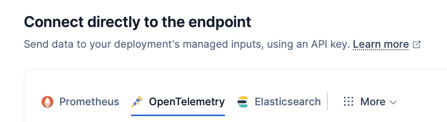
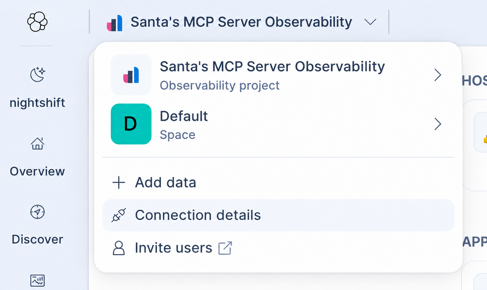
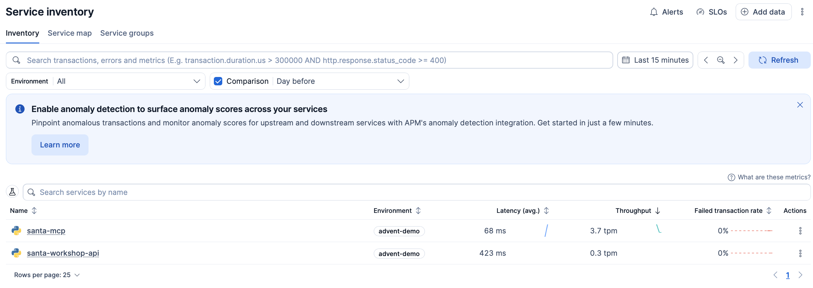
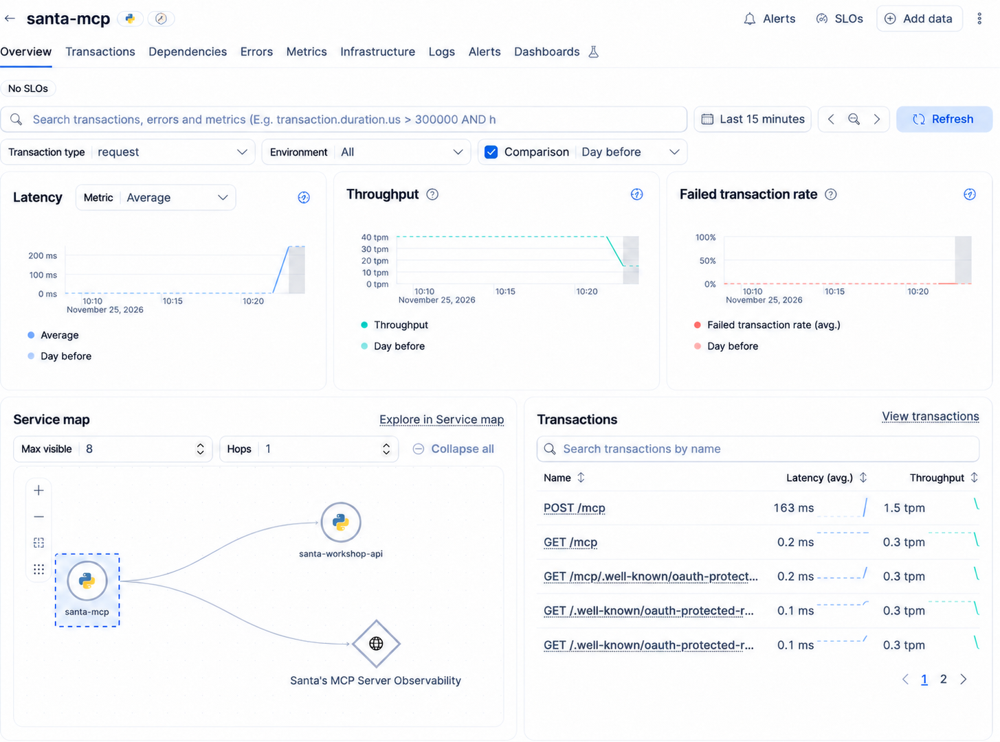
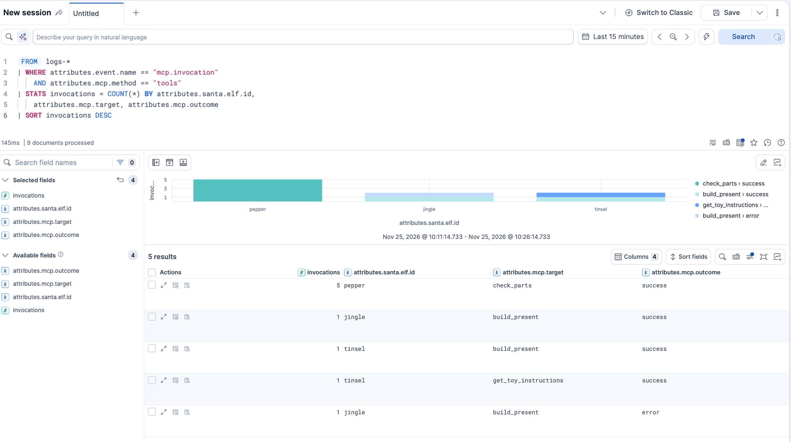
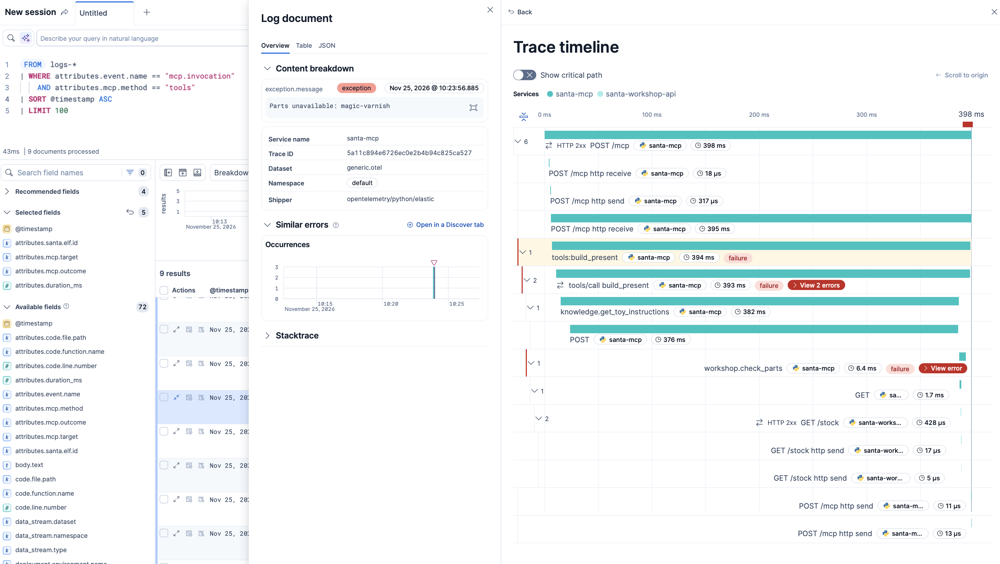

# Instrumenting Santa's MCP Server with OpenTelemetry

A small Advent Calendar demo: elves use an MCP server to build presents, while Santa compares tool usage by elf, follows requests across services, and diagnoses failed builds in Elastic.

The demo contains two Python services: a FastMCP server exposing the workshop tools and a mock HTTP API representing the manufacturing system. Elasticsearch stores the toy assembly instructions. No LLM subscription is needed to generate scripted traffic.

The MCP server exposes three tools:

- `get_toy_instructions` searches Elasticsearch for a toy's assembly instructions.
- `check_parts` reads the workshop's stock.
- `build_present` retrieves instructions, checks components, and requests manufacturing.

The toys are `teddy-bear`, `wooden-train`, and `rocking-horse`. Elves use the fictional identities `pepper`, `tinsel`, and `jingle` as tool arguments.

## Start locally

Install [uv](https://docs.astral.sh/uv/), then run from this directory:

```sh
uv sync --frozen
cp .env.example .env
```

Configure the two endpoint/key pairs in `.env` [below](#connect-elastic-serverless). Telemetry is on by default. Open two terminals in the demo directory. In **both terminals**, activate the environment and export the settings before starting OpenTelemetry:

```sh
source .venv/bin/activate
set -a
source .env
set +a
```

In **terminal 1**, seed the toy instructions once, then start the workshop API at `http://127.0.0.1:8001`:

```sh
santa-setup-elastic
OTEL_SERVICE_NAME=santa-workshop-api opentelemetry-instrument santa-workshop
```

In **terminal 2**, start the MCP endpoint at `http://127.0.0.1:8000/mcp`:

```sh
OTEL_SERVICE_NAME=santa-mcp opentelemetry-instrument santa-mcp
```

Leave both running. In a third terminal, generate traffic:

```sh
uv run --no-sync santa-traffic
```

Santa's MCP server searches Elasticsearch for instructions and calls the workshop API to build toys. Traces, metrics, and logs go to the Managed OTLP endpoint.

`santa-traffic` verifies 10 tool calls: nine successes and one missing-parts error. The train pauses in the paint booth for two seconds by default. Restart the workshop API to reset stock before repeating.

## Run with Docker Compose

With Docker running and the telemetry settings configured in your shell or `.env`:

```sh
docker compose up --build -d --wait
docker compose run --rm traffic
```

Only the MCP port is published, bound to localhost. Both services use the same image. Reset stock with `docker compose restart workshop`. Stop with `docker compose down`.

## Connect Elastic Serverless

Sign up for [Elastic Cloud](https://cloud.elastic.co/registration), or sign in with your existing account. Create an [Elastic Observability Serverless project](https://www.elastic.co/docs/solutions/observability/get-started) and select **Observability Complete** for the logs, metrics, and APM walkthrough. Once the project is ready, open it to configure the connections below.

The project provides an Elasticsearch endpoint and a Managed OTLP endpoint. Configure two keys: one for telemetry and one for seeding and searching instructions.

### Configure the two connections

Edit `.env`:

```dotenv
OTEL_EXPORTER_OTLP_ENDPOINT="https://<managed-otlp-endpoint>"
OTEL_EXPORTER_OTLP_HEADERS="Authorization=ApiKey%20<ingestion-key>"
ELASTICSEARCH_URL="https://<your-elasticsearch-endpoint>"
ELASTICSEARCH_API_KEY="<elasticsearch-key>"
```

Open your project's onboarding page at `https://<your_serverless_project_url>/app/observabilityOnboarding`. Scroll to **Connect directly to the endpoint** and select **OpenTelemetry**. Copy the Managed OTLP endpoint into `OTEL_EXPORTER_OTLP_ENDPOINT`, then generate an ingestion API key and set `OTEL_EXPORTER_OTLP_HEADERS` as shown above.



Open **Connection details** from the project menu. Copy the Elasticsearch endpoint into `ELASTICSEARCH_URL` and generate an API key for `ELASTICSEARCH_API_KEY` to seed and search toy assembly instructions.



The ingest host's `/_es` endpoint supports bulk ingestion, not instruction searches; use the regular Elasticsearch endpoint for `ELASTICSEARCH_URL`. [Managed bulk endpoint limitations](https://www.elastic.co/docs/reference/managed-inputs/elasticsearch-bulk#limitations)

`ELASTICSEARCH_API_KEY` is the encoded key without the `ApiKey ` prefix. Use the same key for setup and searches. Grant `read`, `view_index_metadata`, `create_index`, `create_doc`, and `maintenance` on `santa-toy-instructions`; `maintenance` allows setup to wait for search visibility. No Kibana or Elastic MCP configuration is needed. [Elasticsearch index privileges](https://www.elastic.co/docs/reference/elasticsearch/security-privileges#privileges-list-indices)

### Seed the toy instructions

```sh
uv run --no-sync santa-setup-elastic
```

This creates `santa-toy-instructions`, seeds three documents, and verifies each through the same `_search` call used by the MCP tools. Existing documents are preserved; different existing instructions are reported rather than replaced. Each lookup uses an exact `toy_id` term query. Failed searches return a tool error.

### Configure telemetry

Copy the **Managed OTLP endpoint** and its ingestion API key from your project's OpenTelemetry onboarding. Export these settings in both terminals where you'll start the services:

```sh
export OTEL_TRACES_EXPORTER=otlp
export OTEL_METRICS_EXPORTER=otlp
export OTEL_LOGS_EXPORTER=otlp
export OTEL_EXPORTER_OTLP_PROTOCOL=http/protobuf
export OTEL_EXPORTER_OTLP_ENDPOINT="https://<your-managed-otlp-endpoint>"
export OTEL_EXPORTER_OTLP_HEADERS="Authorization=ApiKey%20<encoded-ingestion-api-key>"
```

Traces, metrics, and logs are enabled by default in `.env.example` and Compose; the three exporter settings are shown explicitly above. Keep `http/protobuf` for this demo's HTTP export path: EDOT's protocol default is `grpc`. You can also save these settings in `.env` without the `export` prefix and load them in both terminals as shown in [Start locally](#start-locally).

Use the base Managed OTLP URL; the exporter appends the signal paths. Its ingestion key sends all three telemetry signals. The Elasticsearch key is used for instruction searches and setup. See [Managed OTLP setup and authentication](https://www.elastic.co/docs/reference/managed-inputs/managed-otlp-endpoint).

For local execution, stop both services, reload `.env` in both terminals if you edited it, and start the services again. For Compose, recreate the services to read the updated environment:

```sh
docker compose up -d --force-recreate --wait
docker compose run --rm traffic
```

Load `.env` **before** `opentelemetry-instrument` starts. Loading it only inside Python would be too late to configure EDOT. The lockfile explicitly includes HTTPX and ASGI instrumentation, so a bootstrap scan is unnecessary for these integrations. If you add libraries, install their instrumentation or use `edot-bootstrap`. Avoid instrumenting the explicit ASGI wrappers a second time.

## Connect an MCP client

With both services running, add a new MCP server in your client's settings (Claude, Codex, Cursor, etc.) named `santas-workshop`, using URL `http://127.0.0.1:8000/mcp` and transport **Streamable HTTP**. Connect and check that it discovers `get_toy_instructions`, `check_parts`, and `build_present`.

A local stdio option is also available:

```sh
uv run --no-sync python -m dotenv run --no-override -- env OTEL_SERVICE_NAME=santa-mcp \
  opentelemetry-instrument santa-mcp --transport stdio
```

Run from the project directory or configure the client's working directory. The workshop API must still be running. Clients that can only reach remote URLs need a deployed endpoint; localhost refers to the machine running the client.

Try these prompts, approving tool calls if your client asks:

> I am Tinsel, using elf_id tinsel. Get the assembly instructions for teddy-bear, then use build_present to build one.

> I am Jingle, using elf_id jingle. Use build_present for one wooden-train, then call it for one rocking-horse.

> I am Pepper, using elf_id pepper. Call check_parts for teddy-bear five times.

Use Elastic to compare tool usage by elf and diagnose the failed build. The same run also includes repeated stock checks and a slower build to explore after the walkthrough. Your assistant may make extra calls or fewer repetitions, so counts can vary; use `santa-traffic` for exact scripted traffic.

Restart the workshop API (`santa-workshop`) to reset stock before repeating builds. With Compose, use `docker compose restart workshop`.

## Instrumentation

FastMCP 3 emits native OpenTelemetry tool spans. Our `tools:<name>` middleware span wraps tool execution and adds `mcp.method`, `mcp.target`, `mcp.outcome`, and `santa.elf.id`. These are demo-specific attributes. The middleware includes them in completion logs using Python's `extra` argument; EDOT exports them with the active trace context, and Elastic's default OTel mappings preserve them under `attributes.*`. Keep field types consistent as you add context. [OpenTelemetry attribute mappings](https://www.elastic.co/docs/reference/opentelemetry/compatibility/data-streams)

Two custom metrics are emitted: `mcp.requests` (counter) and `mcp.request.duration` (histogram in **seconds**). Both carry operation, target, outcome, and one of three bounded fictional elf identities. Build IDs and raw arguments are not metric dimensions. Completion logs use `event.name=mcp.invocation` and record `duration_ms` in milliseconds. Use rates or deltas for the cumulative counter rather than summing cumulative samples as request counts.

The `knowledge.get_toy_instructions` span measures the Elasticsearch instruction search. The MCP server adds spans for `workshop.check_parts` and `workshop.build`; the workshop API adds assembly, painting, and wrapping spans. HTTPX injects trace context into outgoing requests, and the workshop's ASGI middleware extracts it so the trace covers both services.

## Check the results in Elastic

### 1. Validate the services in APM

Open **APM → Services** and set the time range. Confirm that `santa-mcp` and `santa-workshop-api` appear in the service inventory under the `advent-demo` environment.



Open `santa-mcp` to inspect its service overview. Check the latency, throughput, and failed transaction rate, then look at the transactions and service map. The map should show the MCP service calling `santa-workshop-api`, and the transaction list should include `POST /mcp`.



Open the service's **Errors** tab as well. The missing-parts exception appears under **APM errors** as `fastmcp.exceptions.ToolError`, with the message `Parts unavailable: magic-varnish`.

### 2. See what each elf is running with ES|QL

Open **Discover** and use the same time range. Count tool calls by elf, tool, and outcome using ESQL. With the native OTLP mappings, per-record attributes are available under `attributes.*`:

```esql
FROM logs-*
| WHERE attributes.event.name == "mcp.invocation"
    AND attributes.mcp.method == "tools"
| STATS invocations = COUNT(*) BY attributes.santa.elf.id,
    attributes.mcp.target, attributes.mcp.outcome
| SORT invocations DESC
```



To follow the individual calls in order, use:

```esql
FROM logs-*
| WHERE attributes.event.name == "mcp.invocation"
    AND attributes.mcp.method == "tools"
| SORT @timestamp ASC
| LIMIT 100
```

### 3. Diagnose the failed build with Discover's stacktrace

Select Jingle's `build_present` completion event with `attributes.mcp.outcome` equal to `error`, then open its trace timeline. Follow the failed `tools/call build_present` span to `workshop.check_parts` and use **View error** to inspect the exception in the log document. Expand **Stacktrace** to find the application frame in `build_present` where the stock check raises `ToolError`.

The exception message is:

```text
Parts unavailable: magic-varnish
```



The rocking horse needs `magic-varnish`, which is unavailable in the demo stock. The trace shows that the stock request reached `santa-workshop-api` and returned HTTP 2xx; the MCP server then rejected the build during `workshop.check_parts`, before manufacturing. This explains both the tool error and the successful HTTP response.

### Try two more investigations

Use the same telemetry to explore the other cases:

- Which successful build takes longer? Compare `attributes.duration_ms`, open its trace, and follow the spans into `santa-workshop-api` to find the step responsible for the delay.
- What context do the logs add? Open the build trace's correlated workshop logs and inspect the custom fields, including `attributes.santa.toy.id`, `attributes.paint.booth.id`, and `attributes.paint.delay_seconds`. Can you write an ES|QL query to find other events from the same paint booth?

## Application behavior

`build_present` retrieves instructions, checks stock, and asks the workshop to manufacture one toy. The API atomically rechecks and reserves its own stock to prevent simultaneous builds overspending inventory. The rocking horse lacks magic varnish. Stock is in memory and resets on workshop restart.

This is a local teaching demo. The `elf_id` is self-reported, not authentication. A production version should derive identity from credentials and use durable build jobs/idempotency and shared inventory.

To host the demo remotely, build and publish the Docker image, then run the MCP server and workshop API with the same Elastic connection settings. The optional [Cloud Run template](infra/cloud-run.yaml) shows how to run both containers in one private service, limited to one instance for the demo's in-memory stock. Connect your MCP client through an authenticated proxy.

## Verify

```sh
uv run --no-sync ruff check src tests
uv run --no-sync pytest -q
docker compose config --quiet
```

The HTTP test starts both services, a fake Elasticsearch HTTP API, and a protobuf OTLP receiver. It verifies seeding and searching with one Elasticsearch key, tool outcomes, cross-service traces, and export of traces, metrics, and correlated logs. It needs localhost ports and no Elastic credentials. Use `pytest -q --ignore=tests/test_http_demo.py` if local ports are prohibited.

Live Elastic ingestion, screenshots, Docker image execution, and Cloud Run deployment require their respective services/environments.
